<div align="center">

# JEREMY SALINAS MAULEON

### Software Engineer · Backend & Mobile Development

<p>
Building scalable systems, reliable backend architectures
and native mobile applications.
</p>

<br/>

<a href="https://github.com/Jery-salinas">

</a>
<a href="https://github.com/Jery-salinas?tab=followers">

</a>
<a href="https://github.com/Jery-salinas?tab=repositories">

</a>

<br/><br/>


</div>

---

## 01 — About Me

```java
public class JeremySalinas {

    private final String name = "Jeremy Salinas Mauleon";
    private final String location = "Veracruz, Mexico";

    private final String education =
        "Computer Engineering - Universidad Veracruzana";

    private final String role = "Software Engineer";

    private final String[] specialties = {
        "Backend Development",
        "Enterprise Architecture",
        "Native Android Development",
        "Database Design"
    };

    private final String[] interests = {
        "Cloud Computing",
        "System Architecture",
        "Automation",
        "Emerging Technologies"
    };

}
```

I'm a Software Engineer focused on designing and developing reliable, scalable and maintainable software solutions.

My experience and interests revolve around backend engineering, enterprise applications, database architecture and native mobile development.

I enjoy understanding complex problems, designing efficient solutions and continuously improving my engineering skills.

- Currently working on enterprise software solutions and native Android applications.
- Interested in scalable backend architectures and cloud technologies.
- Exploring modern software engineering practices and system design.
- Always looking for opportunities to learn, build and improve.

---

## 02 — Engineering Expertise

<table>
<tr>
<td width="50%" valign="top">

### Backend Engineering

- RESTful API Development
- Enterprise Applications
- Object-Oriented Programming
- Software Architecture
- Authentication & Authorization
- Business Logic Development

</td>
<td width="50%" valign="top">

### Mobile Engineering

- Native Android Development
- Kotlin
- Jetpack Compose
- MVVM Architecture
- Local Data Persistence
- Responsive UI Development

</td>
</tr>
<tr>
<td width="50%" valign="top">

### Database Engineering

- Relational Database Design
- SQL & Query Optimization
- Data Modeling
- Database Management
- Transaction Management

</td>
<td width="50%" valign="top">

### Cloud & Infrastructure

- Cloud Application Architecture
- Azure
- Docker
- CI/CD Concepts
- Git & Version Control
- Deployment & Integration

</td>
</tr>
</table>

---

## 03 — Technology Stack

### Programming Languages

<p>

</p>

### Frameworks & Libraries

<p>

</p>

### Databases & Cloud

<p>

</p>

### Development Tools

<p>

</p>

---

## 04 — Featured Projects

<table>
<tr>
<td width="50%" valign="top">

<h3>Enterprise FinTech Platform</h3>

<strong>CONFIDENTIAL PROJECT</strong>

Secure enterprise ecosystem designed to support automated financial operations.

**Key Features**

- Identity verification workflows
- OCR document processing
- Secure document management
- Cloud-based architecture
- Financial process automation

**Technologies**

`Python` `Django` `PostgreSQL` `Azure`

</td>
<td width="50%" valign="top">

<h3>DT Manager</h3>

<strong>PERSONAL PROJECT</strong>

Native Android application focused on amateur football team management.

**Key Features**

- Team management
- Player statistics
- Match calendars
- Lineup organization
- Local data persistence

**Technologies**

`Kotlin` `Jetpack Compose` `Room`

</td>
</tr>

<tr>
<td width="50%" valign="top">

<h3>RecoWeb</h3>

<strong>ACADEMIC PROJECT</strong>

Web platform for managing electronic waste collection, diagnosis, repair and recycling processes.

**Key Features**

- Electronic waste registration
- Technical diagnosis
- Repair management
- Inventory management
- Reports and tracking

**Technologies**

`Java` `ZK Framework` `SQL` `MVC`

</td>
<td width="50%" valign="top">

<h3>More Projects</h3>

I'm continuously working on new ideas and improving my engineering skills through practical software development.

Explore my repositories to discover more experiments, applications and technical implementations.

<br/><br/>

<a href="https://github.com/Jery-salinas?tab=repositories">

</a>

</td>
</tr>
</table>

---

## 05 — GitHub Analytics

<div align="center">

<a href="https://github.com/Jery-salinas">

</a>
<a href="https://github.com/Jery-salinas">

</a>

<br/><br/>

<a href="https://github.com/Jery-salinas?tab=repositories">

</a>

</div>

---

## 06 — Currently Exploring

<table>
<tr>
<td width="50%" valign="top">

### Cloud & Infrastructure

- AWS Cloud
- Docker & Containerization
- Kubernetes
- Cloud Architecture

</td>
<td width="50%" valign="top">

### Software Engineering

- Advanced Java
- Spring Boot
- Enterprise Architecture
- Oracle Java Certification

</td>
</tr>
</table>

---

## 07 — Beyond the Code

Outside software development, I enjoy football, technology, problem-solving and exploring new ideas.

I believe continuous learning and practical experience are essential to becoming a better engineer.

---

## 08 — Let's Connect

<div align="center">

<a href="https://github.com/Jery-salinas">

</a>

<!-- Add your actual LinkedIn URL -->

<!--
<a href="YOUR_LINKEDIN_URL">

</a>
-->

<!-- Add your portfolio URL -->

<!--
<a href="YOUR_PORTFOLIO_URL">

</a>
-->

<!-- Add your professional email -->

<!--
<a href="mailto:YOUR_EMAIL">

</a>
-->

<br/><br/>

<h3>Engineering solutions. Building possibilities.</h3>

<sub>Designed & Developed by Jeremy Salinas Mauleon · 2026</sub>

</div>
